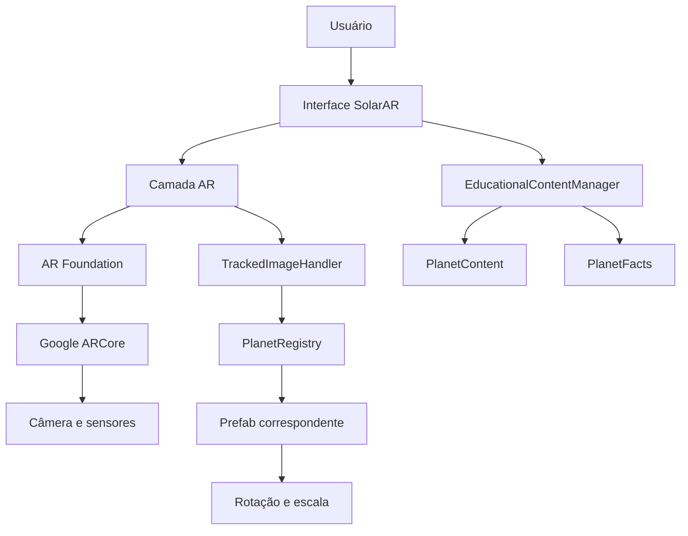
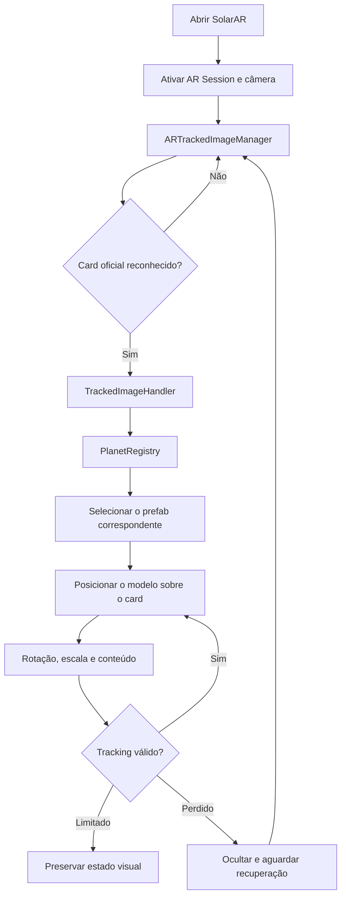

# SolarAR

> **Projeto acadêmico — UPX: Realidade Aumentada**  
> Aplicação educacional em Realidade Aumentada para exploração do Sistema Solar por meio de cards físicos interativos.


---

## 1. Identificação do projeto

| Item | Informação |
|---|---|
| **Projeto** | SolarAR — Sistema Educacional do Sistema Solar em Realidade Aumentada |
| **Equipe** | SolarAR |
| **Curso** | Engenharia da Computação |
| **Disciplina** | UPX — Realidade Aumentada |
| **Docentes** | Daniel Ohata, Jéssica Danila Silva e Rosana Antonio |
| **Instituição** | Centro Universitário Facens — Sorocaba/SP |
| **Semestre** | 2026.2 |

### Integrantes

| Nome | RA | Responsabilidade |
|---|---|---|
| Emily Kaori Uehara Soares | 235470 | Tech Lead; desenvolvimento Unity, integração de RA e testes |
| Kevin Suzuki Scavassin | 235185 | PMO; planejamento e acompanhamento do projeto |
| Renan Lara Melo | 235268 | Scrum Master; organização do fluxo de trabalho |
| Roberto Dutra Fernandes Filho | 235789 | Pesquisa e desenvolvimento |
| Éric Ferreira de Arruda | 211393 | Modelagem e desenvolvimento |

---

## 2. Visão geral

O **SolarAR** é uma aplicação educacional em Realidade Aumentada voltada à aprendizagem introdutória do Sistema Solar. Ao apontar a câmera de um smartphone Android para um card cadastrado, a aplicação reconhece a imagem e exibe sobre ela o modelo tridimensional do planeta correspondente.

O MVP implementa sete planetas: **Mercúrio, Terra, Marte, Júpiter, Saturno, Urano e Netuno**. Cada card oficial reconhece somente o prefab correspondente. A galeria também permite explorar os mesmos modelos e conteúdos educacionais sem usar a câmera. Vênus, Sol, Lua como objetos visualizáveis e áudio explicativo não fazem parte desta versão.

O usuário pode observar o planeta em 3D, rotacioná-lo, redimensioná-lo e consultar informações educacionais curtas. A interface prioriza previsibilidade, poucos estímulos simultâneos e controles simples.

---

## 3. Problema e objetivo

O ensino do Sistema Solar costuma depender de imagens bidimensionais, diagramas e explicações abstratas. Para crianças em fase de alfabetização, compreender formas e relações espaciais pode ser difícil quando o conteúdo é apresentado somente em livros ou telas planas.

O SolarAR associa um elemento físico simples — um card — a uma representação 3D interativa. O objetivo não é substituir a mediação pedagógica, mas oferecer uma forma visual e concreta de exploração.

### Objetivos técnicos

- executar uma experiência de Realidade Aumentada em Android;
- utilizar AR Foundation e Google ARCore;
- reconhecer cards por **Image Tracking**;
- associar cada imagem de referência a um único prefab de planeta;
- exibir e manter o modelo 3D sobre o card rastreado;
- permitir rotação automática, rotação manual e redimensionamento com limites;
- permitir troca de cards durante a mesma sessão de AR;
- disponibilizar conteúdo educacional configurável;
- tratar reconhecimento, perda e recuperação de tracking;
- permitir a visualização dos planetas sem câmera;
- testar no XR Simulation e em dispositivo Android compatível;
- gerar um APK instalável do MVP.

---

## 4. Público-alvo e acessibilidade

O público-alvo é composto por **crianças em fase de alfabetização, aproximadamente entre 6 e 11 anos**, em contextos introdutórios de aprendizagem sobre o Sistema Solar.

A solução foi projetada com:

- instruções curtas e consistentes;
- interação direta;
- apenas um planeta em destaque por vez;
- conteúdo visual e textual simples;
- controles grandes e previsíveis;
- baixa quantidade de estímulos simultâneos;
- informação que não depende somente de cor ou áudio.

Nesta etapa não foi realizado experimento direto com crianças. Decisões de acessibilidade ainda devem ser validadas com pessoas qualificadas e, quando possível, com representantes do público-alvo.

---

## 5. Funcionalidades

| ID | Funcionalidade | Descrição | Status |
|---|---|---|---|
| RF01 | Iniciar experiência AR | Inicializa a cena principal com câmera e sistemas de AR | ✅ |
| RF02 | Reconhecer cards oficiais | Detecta os sete cards físicos cadastrados | ✅ |
| RF03 | Exibir planeta em 3D | Instancia somente o prefab associado ao card reconhecido | ✅ |
| RF04 | Acompanhar tracking | Atualiza a pose do planeta conforme o card rastreado | ✅ |
| RF05 | Recuperar tracking | Mantém ou recupera o planeta conforme o estado do tracking | ✅ |
| RF06 | Rotação automática | Mantém rotação suave do modelo visual | ✅ |
| RF07 | Rotação manual | Permite que o usuário rotacione o planeta | ✅ |
| RF08 | Zoom por gesto | Redimensiona o planeta com limites seguros | ✅ |
| RF09 | Troca de cards | Permite reconhecer outro card na mesma sessão | ✅ |
| RF10 | Conteúdo educacional | Exibe dados e curiosidades dos sete planetas | ✅ |
| RF11 | Galeria de planetas | Permite explorar os sete planetas sem câmera | ✅ |
| RF12 | Interface e navegação | Exibe instruções, feedback e controles | ✅ |
| RF13 | Áudio educacional | Fora do escopo desta versão | ❌ |

**Legenda:** ✅ Implementado · 🚧 Em desenvolvimento · ⬜ Planejado · ❌ Fora do escopo

### Requisitos não funcionais

| ID | Categoria | Requisito |
|---|---|---|
| RNF01 | Compatibilidade | Executar em dispositivo Android compatível com ARCore |
| RNF02 | Usabilidade | Apresentar instruções claras e interação simples |
| RNF03 | Desempenho | Manter o modelo 3D utilizável durante o tracking |
| RNF04 | Hardware | Requer câmera traseira e suporte a ARCore para o modo AR |
| RNF05 | Tracking | O card deve permanecer suficientemente visível |
| RNF06 | Interface | Respeitar Safe Area e diferentes proporções de tela Android |
| RNF07 | Manutenibilidade | Separar AR, planetas, interação, educação e UI |
| RNF08 | Segurança | Não armazenar imagens da câmera nem utilizar credenciais sensíveis |

---

## 6. Tecnologias utilizadas

| Tecnologia | Versão | Utilização |
|---|---|---|
| Unity | **6000.6.4f1** | Engine principal |
| C# | Compatível com Unity 6 | Programação da aplicação |
| AR Foundation | **6.6.2** | Camada de abstração de AR |
| Google ARCore XR Plugin | **6.6.2** | Provider de AR no Android |
| XR Plug-in Management | **4.7.0** | Configuração dos loaders XR |
| XR Simulation | **6.6.2** | Simulação da experiência no Editor |
| glTFast | **6.20.0** | Importação do modelo GLB |
| Input System | **1.20.0** | Entrada e interações |
| Universal Render Pipeline | **17.6.0** | Pipeline gráfico |
| Blender | **4.4.3** | Preparação de recursos 3D |
| Git / GitHub | — | Controle de versão e repositório |
| Figma | — | Referência e especificação de UI/UX |

As dependências estão registradas em `UnityApp/Packages/manifest.json` e `UnityApp/Packages/packages-lock.json`.

---

## 7. Arquitetura

A arquitetura mantém o módulo de AR separado de interação, planetas, dados educacionais e interface.



### Módulos principais

- `AR`: reconhecimento e ciclo de vida do tracking;
- `Planets`: modelos, prefabs, dados de exibição e comportamentos visuais;
- `Interaction`: gestos de rotação e escala;
- `Education`: dados e curiosidades independentes da lógica de AR;
- `UI`: navegação, instruções, feedback e apresentação visual;
- `Editor`: construção e validação automatizada do MVP dentro do Unity.

### Principais scripts e componentes

| Script / componente | Responsabilidade |
|---|---|
| `TrackedImageDebugLogger.cs` | Registra mudanças relevantes de tracking durante desenvolvimento e testes |
| `TrackedImageHandler.cs` | Processa o ciclo de vida do `ARTrackedImage` e controla a instância ativa |
| `PlanetRegistry.cs` | Mapeia o nome da imagem de referência para `planetKey` e prefab |
| `RotationController.cs` | Controla a rotação automática do modelo visual |
| `EarthGestureController.cs` | Interpreta rotação manual e gesto de pinça para o planeta ativo |
| `PlanetDisplay.cs` | Identifica o planeta exibido |
| `PlanetPreviewController.cs` | Controla a visualização de planetas sem câmera |
| `PlanetContent.cs` | Define os dados educacionais de um planeta |
| `PlanetFacts.cs` | Agrupa curiosidades por planeta |
| `EducationalContentManager.cs` | Fornece conteúdo usando `planetKey` |
| `EarthMvpUI.cs` | Coordena estados e navegação da interface do MVP |
| `SolarARReferenceImageLibrary` | Biblioteca com os sete cards oficiais |

---

## 8. Funcionamento da Realidade Aumentada

O SolarAR utiliza **Image Tracking**. Os sete cards são cadastrados em uma `XRReferenceImageLibrary`. Quando o ARCore reconhece uma imagem, o AR Foundation fornece um `ARTrackedImage` com nome de referência, pose e estado de tracking.



Estados tratados:

- **Tracking:** planeta ativo e pose atualizada;
- **Limited:** perda temporária de precisão; a experiência é preservada quando possível;
- **None:** instância pode ser ocultada;
- **Removed:** vínculo e instância associados são removidos.

O registro atual associa explicitamente:

| Imagem de referência | Planeta |
|---|---|
| `MercuryCard` | Mercúrio |
| `EarthCard` | Terra |
| `MarsCard` | Marte |
| `JupiterCard` | Júpiter |
| `SaturnCard` | Saturno |
| `UranusCard` | Urano |
| `NeptuneCard` | Netuno |

---

## 9. Estrutura do projeto

```text
SolarAR/
├── UnityApp/
│   ├── Assets/
│   │   ├── Editor/
│   │   └── SolarAr/
│   │       ├── AR/
│   │       │   ├── ReferenceImages/
│   │       │   └── Scripts/
│   │       ├── Branding/
│   │       ├── Education/
│   │       │   ├── Data/
│   │       │   ├── Facts/
│   │       │   └── Scripts/
│   │       ├── Interaction/
│   │       ├── Planets/
│   │       │   ├── Models/
│   │       │   ├── Prefabs/
│   │       │   └── Scripts/
│   │       ├── Scenes/
│   │       ├── Simulation/
│   │       └── UI/
│   ├── Packages/
│   └── ProjectSettings/
├── docs/
│   └── design/
├── AGENTS.md
├── LICENSE
└── README.md
```

Recursos próprios ficam em `UnityApp/Assets/SolarAr`. A cena principal é `UnityApp/Assets/SolarAr/Scenes/MainAR.unity`.

---

## 10. Configuração do ambiente

### Pré-requisitos

- Unity Hub;
- Unity **6000.6.4f1**;
- Android Build Support;
- Android SDK & NDK Tools;
- OpenJDK;
- Git;
- smartphone Android compatível com ARCore para teste real.

### Instalação

```bash
git clone https://github.com/Emilyksori/SolarAR.git
cd SolarAR
```

1. No Unity Hub, abra a pasta `SolarAR/UnityApp`.
2. Aguarde a importação dos pacotes.
3. Abra `Assets/SolarAr/Scenes/MainAR.unity`.
4. Em XR Plug-in Management, confirme:
   - Android → ARCore Loader;
   - Editor/Standalone → XR Simulation.

Não é necessário atualizar a versão do Unity nem os pacotes para abrir o estado documentado do projeto.

---

## 11. Como executar

### XR Simulation no Editor

1. Abra `MainAR.unity`.
2. Verifique se `SolarAR_Backyard` está selecionado nas preferências de XR Simulation.
3. Clique em **Play**.
4. Navegue até `EarthCard_Simulated`.
5. Aponte a câmera simulada para o card e aguarde o reconhecimento.

### Gerar APK Android

1. Abra **File → Build Profiles**.
2. Selecione **Android**.
3. Confirme que `MainAR` está incluída.
4. Clique em **Build**.
5. Salve, por exemplo, em `UnityApp/Builds/Android/SolarAR.apk`.

Instalação por ADB:

```bash
adb devices
adb install -r UnityApp/Builds/Android/SolarAR.apk
```

---

## 12. Como utilizar

1. Abra o SolarAR no smartphone.
2. Autorize o acesso à câmera quando solicitado.
3. Posicione um dos sete cards oficiais em uma superfície visível.
4. Aponte a câmera para o card e aguarde o reconhecimento.
5. Observe o planeta correspondente em 3D.
6. Arraste para rotacionar e use o gesto de pinça para alterar a escala.
7. Consulte as informações educacionais.
8. Para trocar de planeta, apresente outro card oficial.
9. Para usar sem câmera, abra a galeria de planetas.
10. Caso o tracking seja perdido, reposicione o card na área visível da câmera.

---

## 13. Interface

A especificação oficial está em [`docs/design/SolarAR-UI-Spec.md`](docs/design/SolarAR-UI-Spec.md). As referências originais exportadas do Figma são:

- `docs/design/figma-styles.jpg`;
- `docs/design/figma-components.jpg`;
- `docs/design/figma-screens.jpg`.

A referência utiliza base visual `412 × 915`, fundo noturno, azul e ciano para navegação e feedback, amarelo para destaque, superfícies claras para conteúdo educacional e tipografia com foco em legibilidade. A implementação respeita Safe Area e inclui estados de procura, reconhecimento e perda de tracking.

---

## 14. Testes técnicos registrados

| Teste | Procedimento | Resultado registrado | Status |
|---|---|---|---|
| Inicialização | Abrir o aplicativo | Aplicação iniciou | ✅ |
| Câmera | Iniciar experiência AR | Câmera disponibilizada | ✅ |
| XR Simulation | Executar `MainAR` no Editor | Ambiente carregado | ✅ |
| Image Tracking | Apontar para `EarthCard` | Card detectado | ✅ |
| Conteúdo 3D | Reconhecer `EarthCard` | Terra exibida | ✅ |
| Tracking | Movimentar e reenquadrar o card | Modelo acompanhou a referência | ✅ |
| Recuperação | Perder e recuperar a referência | Experiência recuperada | ✅ |
| Rotação | Exibir e manipular o planeta | Rotação funcionou | ✅ |
| Escala | Executar gesto de pinça | Escala permaneceu utilizável | ✅ |
| Conteúdo educacional | Abrir informações | Dados e fatos exibidos | ✅ |
| Build Android | Gerar APK | APK gerado | ✅ |
| Android real | Instalar e executar | MVP funcionou | ✅ |

Os resultados acima registram validações realizadas durante o desenvolvimento. A consolidação Git, por si só, não substitui uma nova validação em dispositivo físico dos sete cards.

### Dispositivo testado

| Dispositivo | Sistema | Versão | Resultado |
|---|---|---|---|
| Smartphone compatível com ARCore | Android | **Não registrada no README** | MVP executado com sucesso |

Para registrar o dispositivo conectado:

```bash
adb shell getprop ro.product.manufacturer
adb shell getprop ro.product.model
adb shell getprop ro.build.version.release
```

---

## 15. Evidências de funcionamento

A solução possui evidência em vídeo do reconhecimento e da interação principal:

[▶ Assistir ao vídeo de demonstração](docs/evidencia_reconhecimento_de_card.mp4)

Capturas adicionais podem ser armazenadas em `docs/images/`, por exemplo:

```text
docs/images/solarar-searching.png
docs/images/solarar-earth-tracking.png
```

Com um smartphone conectado por ADB:

```bash
mkdir -p docs/images
adb exec-out screencap -p > docs/images/solarar-earth-tracking.png
```

---

## 16. Limitações conhecidas

- a versão atual implementa sete planetas e não inclui Vênus;
- o Image Tracking depende da visibilidade e qualidade da imagem de referência;
- iluminação inadequada pode reduzir a estabilidade do reconhecimento;
- os cards físicos oficiais medem `60 × 80 mm` e ainda devem ser validados individualmente no aparelho;
- a interface ainda pode receber refinamentos de fidelidade visual em relação ao Figma;
- áudio educacional não faz parte desta versão;
- a compatibilidade foi verificada somente no dispositivo Android utilizado pela equipe;
- fabricante, modelo e versão do Android ainda precisam ser registrados.

---

## 17. Problemas encontrados e soluções

### XR Simulation sem Image Tracking ativo

**Problema:** o ambiente simulado aparecia, mas o `ARTrackedImageManager` não recebia eventos.

**Causa:** o Fast Enter Play Mode mantinha o XR loader em estado persistente.

**Solução:** restaurar o ciclo completo de Play Mode para reinicializar os subsistemas XR.

### Tamanho físico inconsistente

**Problema:** `EarthCard_Simulated` utilizava dimensões diferentes da biblioteca.

**Causa:** imagem simulada configurada como `1 × 1 m`, enquanto os cards oficiais medem `0,06 × 0,08 m`.

**Solução:** alinhar as dimensões do objeto simulado às cadastradas na biblioteca.

### Terra não aparecia após o reconhecimento

**Problema:** o tracking detectava `EarthCard`, mas o planeta não era exibido.

**Causa:** inconsistências na associação e no ciclo de vida controlado por `PlanetRegistry` e `TrackedImageHandler`.

**Solução:** revisar `EarthCard → EarthPrefab` e garantir instanciação e ativação nos estados corretos.

### Instabilidade em `Limited`

**Problema:** pequenas oscilações faziam o planeta desaparecer.

**Causa:** a instância era desativada sempre que o estado deixava de ser `Tracking`.

**Solução:** tratar `Limited` como perda temporária e preservar a experiência quando possível.

### Build And Run sem dispositivo

**Problema:** o build foi inicialmente reportado como falha.

**Causa:** uso de **Build And Run** sem Android conectado.

**Solução:** utilizar **Build** para gerar o APK e instalá-lo depois por ADB.

---

## 18. Melhorias futuras

- validar individualmente os sete cards físicos em mais dispositivos Android;
- registrar fabricante, modelo e versão do Android testado;
- adicionar capturas reais em `docs/images/`;
- expandir o conteúdo educacional somente após aprovação de escopo;
- refinar a interface para maior fidelidade ao Figma;
- realizar avaliação exploratória de adequação pedagógica.

---

## 19. Recursos e licença

| Recurso | Link / local |
|---|---|
| Código-fonte | https://github.com/Emilyksori/SolarAR |
| Especificação UI | `docs/design/SolarAR-UI-Spec.md` |
| Referências Figma | `docs/design/figma-styles.jpg`, `figma-components.jpg`, `figma-screens.jpg` |
| Cena principal | `UnityApp/Assets/SolarAr/Scenes/MainAR.unity` |
| Créditos do modelo 3D | `UnityApp/Assets/SolarAr/Planets/Models/CREDITS.md` |
| Evidência em vídeo | `docs/evidencia_reconhecimento_de_card.mp4` |

Projeto acadêmico desenvolvido para fins educacionais na disciplina **UPX — Realidade Aumentada**, do curso de Engenharia da Computação do Centro Universitário Facens. Os recursos de terceiros permanecem sujeitos às respectivas licenças.

---

## 20. Controle de versão

O projeto utiliza Git e GitHub com branches curtas e commits descritivos baseados em Conventional Commits simplificado:

```text
feat: nova funcionalidade
fix: correção de bug
docs: documentação
chore: configuração ou manutenção
```

O histórico registra a evolução de AR Foundation, XR Simulation, Image Tracking, integração da Terra, expansão para sete planetas, conteúdo educacional, UI e MVP Android.

---

## Checklist de entrega

- [x] Código-fonte atualizado
- [x] README alinhado ao estado de sete planetas
- [x] Versões das principais tecnologias registradas
- [x] Arquitetura e funcionamento de AR documentados
- [x] Estrutura, scripts, configuração e execução documentados
- [x] Testes históricos e limitações registrados
- [x] Evidência em vídeo referenciada
- [x] RAs dos integrantes conferidos
- [ ] Fabricante, modelo e versão do Android conferidos
- [ ] Sete cards físicos revalidados individualmente após a consolidação
- [ ] Capturas adicionais incluídas em `docs/images/`

> Este README representa o estado consolidado do SolarAR: um MVP Android com sete cards configurados, modelos 3D interativos em AR e sem câmera, conteúdo educacional configurável e interface baseada na especificação oficial do projeto.
