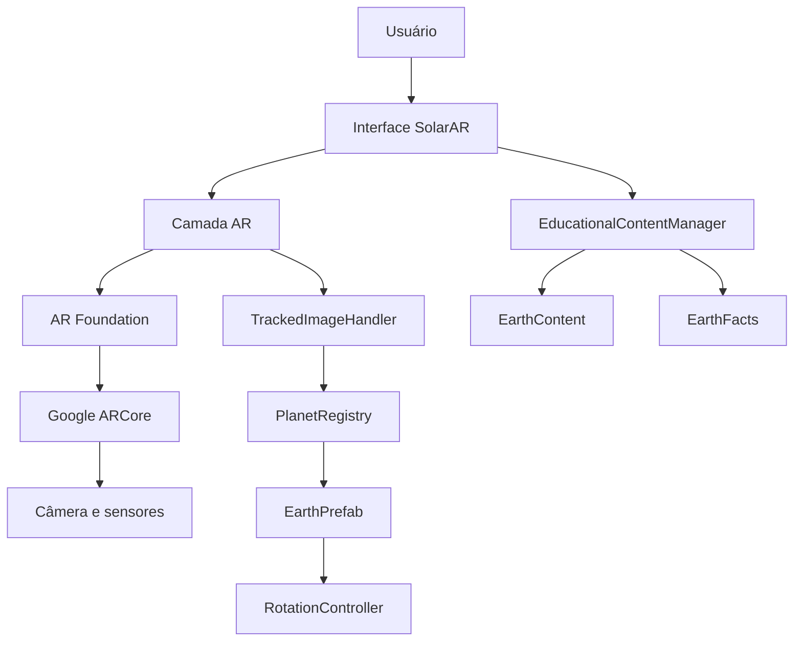
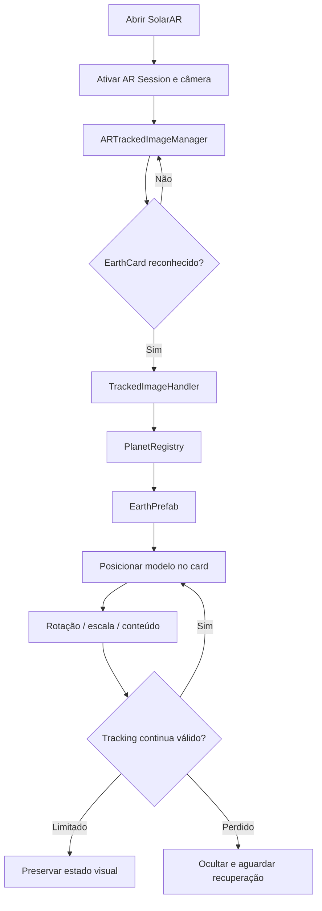
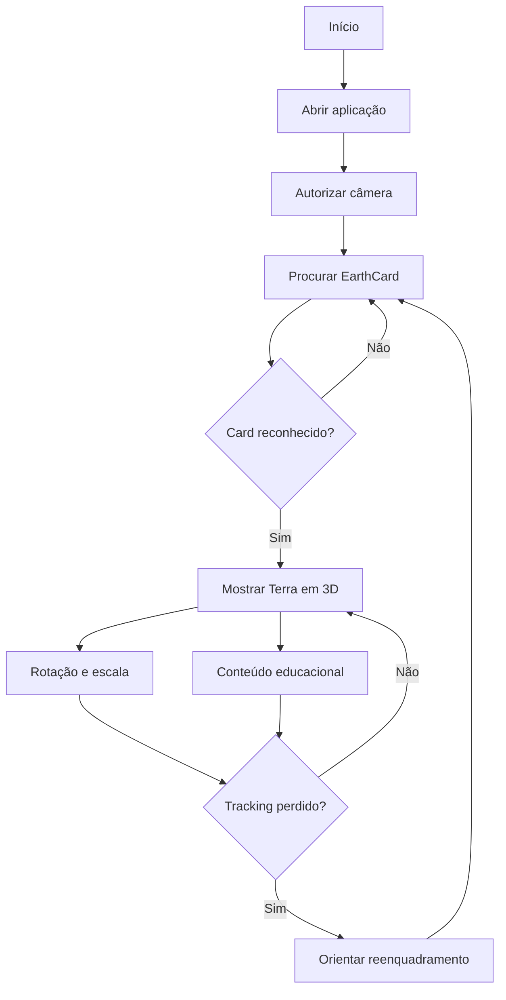
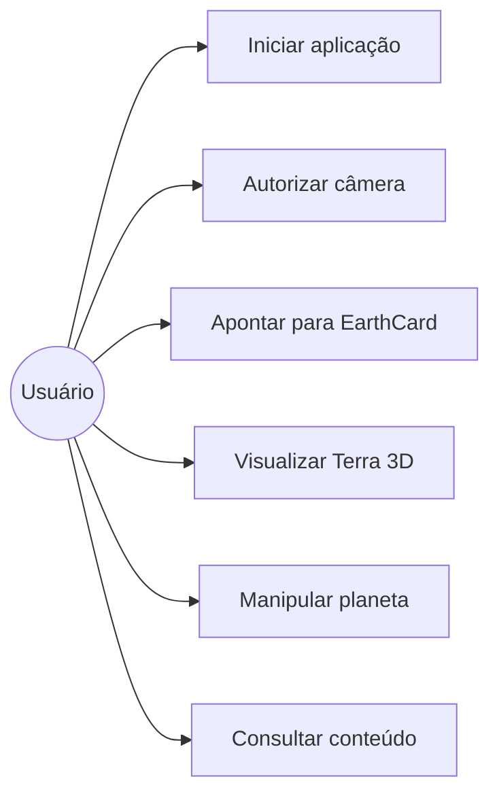

> **Projeto acadêmico — UPX: Realidade Aumentada**  
> Aplicação educacional em Realidade Aumentada para exploração do Sistema Solar por meio de cards físicos interativos.


---

## 1. Identificação do Projeto

| Item | Informação |
|---|---|
| **Projeto** | SolarAR — Sistema Educacional do Sistema Solar em Realidade Aumentada |
| **Equipe** | SolarAR |
| **Curso** | Engenharia da Computação |
| **Disciplina** | UPX — Realidade Aumentada |
| **Docentes** | Daniel Ohata, Jéssica Danila Silva e Rosana Antonio |
| **Instituição** | Centro Universitário Facens — Sorocaba/SP |
| **Semestre** | 2026.2 |

### Integrantes

| Nome | RA | Responsabilidade |
|---|---|---|
| Emily Kaori Uehara Soares| 235470 | Tech Lead; desenvolvimento Unity, integração de RA e testes |
| Kevin Suzuki Scavassin | 235185 | PMO; planejamento e acompanhamento do projeto |
| Renan Lara Melo | 235268 | Scrum Master; organização do fluxo de trabalho |
| Roberto Dutra Fernandes Filho | 235789 | Pesquisa e desenvolvimento |
| Éric Ferreira de Arruda | 211393 | Modelagem e desenvolvimento |

---

## 2. Visão Geral

O **SolarAR** é uma aplicação educacional em Realidade Aumentada voltada à aprendizagem introdutória do Sistema Solar. A proposta utiliza cards físicos como referências visuais: ao apontar a câmera de um smartphone Android para um card cadastrado, a aplicação reconhece a imagem e exibe sobre ela um modelo tridimensional do planeta correspondente.

O projeto busca tornar a visualização dos planetas mais concreta e interativa do que representações exclusivamente bidimensionais. O usuário pode observar o planeta em 3D, manipulá-lo e consultar informações educacionais curtas.

No estágio atual da entrega, o MVP implementa sete planetas: **Mercúrio, Terra, Marte, Júpiter, Saturno, Urano e Netuno**. Cada card oficial reconhece somente o prefab correspondente, e a galeria permite explorar os mesmos modelos e conteúdos educacionais sem câmera. Vênus não faz parte desta versão.

---

## 3. Problema

O ensino do Sistema Solar costuma depender de imagens bidimensionais, diagramas e explicações abstratas. Para crianças em fase de alfabetização, compreender relações espaciais, forma dos planetas e representação tridimensional pode ser difícil quando o conteúdo é apresentado somente em livros ou telas planas.

O SolarAR foi desenvolvido como um recurso educacional complementar que associa um elemento físico simples — um card — a uma representação 3D interativa. O objetivo não é substituir a mediação pedagógica, mas oferecer uma forma visual e concreta de exploração.

A interface prioriza instruções curtas, previsibilidade, poucos elementos simultâneos e interação simples.

---

## 4. Objetivos

### 4.1 Objetivo Geral

Desenvolver uma aplicação educacional em Realidade Aumentada baseada em cards interativos dos planetas para apoiar a aprendizagem introdutória do Sistema Solar.

### 4.2 Objetivos Técnicos

- Configurar um projeto Unity para execução de Realidade Aumentada em Android.
- Utilizar AR Foundation como camada de abstração de RA.
- Utilizar Google ARCore como provedor de RA no Android.
- Implementar reconhecimento de cards por **Image Tracking**.
- Associar cada imagem de referência a um prefab de planeta.
- Exibir um modelo 3D sobre o card reconhecido.
- Permitir rotação e redimensionamento do planeta.
- Disponibilizar conteúdo educacional configurável.
- Tratar estados de tracking, incluindo reconhecimento, perda e recuperação.
- Testar o protótipo no XR Simulation e em dispositivo Android real.
- Gerar um APK instalável do MVP.

---

## 5. Público-Alvo

O público-alvo do SolarAR é composto por **crianças em fase de alfabetização, aproximadamente entre 6 e 11 anos**, em contextos introdutórios de aprendizagem sobre o Sistema Solar.

A solução foi projetada para possuir:

- instruções curtas;
- interação direta;
- apenas um planeta em destaque por vez;
- conteúdo visual e textual simples;
- controles grandes e previsíveis;
- baixa quantidade de estímulos simultâneos.

Nesta etapa do projeto não foi realizado experimento direto com crianças.

---

## 6. Funcionalidades

| ID | Funcionalidade | Descrição | Status |
|---|---|---|---|
| RF01 | Iniciar experiência RA | Inicializa a cena principal com câmera e sistemas de RA | ✅ |
| RF02 | Reconhecer cards oficiais | Detecta os sete cards físicos cadastrados | ✅ |
| RF03 | Exibir planeta em 3D | Instancia o prefab associado ao card reconhecido | ✅ |
| RF04 | Acompanhar tracking | Atualiza a pose do planeta conforme o card rastreado | ✅ |
| RF05 | Recuperar tracking | Mantém/recupera o planeta conforme o estado do tracking | ✅ |
| RF06 | Rotação automática | Mantém rotação suave do modelo visual selecionado | ✅ |
| RF07 | Interagir com o planeta | Permite manipulação do modelo durante a experiência | ✅ |
| RF08 | Redimensionar planeta | Permite alteração de escala com limites seguros | ✅ |
| RF09 | Conteúdo educacional | Disponibiliza dados e curiosidades dos sete planetas | ✅ |
| RF10 | Interface educacional | Exibe feedback e informações relacionadas ao planeta | ✅ |
| RF11 | Galeria de planetas | Permite explorar sete planetas sem câmera | ✅ |
| RF12 | Áudio educacional | Fora do escopo desta versão | ❌ |

**Legenda:** ✅ Implementado · 🚧 Em desenvolvimento · ⬜ Planejado · ❌ Cancelado

---

## 7. Requisitos Não Funcionais

| ID | Categoria | Requisito |
|---|---|---|
| RNF01 | Compatibilidade | Executar em dispositivo Android compatível com ARCore |
| RNF02 | Usabilidade | Apresentar instruções claras e interação simples |
| RNF03 | Desempenho | Manter o modelo 3D utilizável durante o tracking |
| RNF04 | Hardware | Requer câmera traseira e suporte a ARCore |
| RNF05 | Tracking | O card deve permanecer suficientemente visível para maior estabilidade |
| RNF06 | Interface | Respeitar Safe Area e diferentes proporções de tela Android |
| RNF07 | Manutenibilidade | Separar responsabilidades entre AR, planetas, interação, educação e UI |
| RNF08 | Segurança | Não armazenar imagens capturadas pela câmera nem utilizar credenciais sensíveis |

---

## 8. Tecnologias Utilizadas

| Tecnologia | Versão | Utilização |
|---|---|---|
| Unity | **6000.6.4f1** | Engine principal |
| C# | Compatível com Unity 6 | Programação da aplicação |
| AR Foundation | **6.6.2** | Camada de abstração de Realidade Aumentada |
| Google ARCore XR Plugin | **6.6.2** | Provider de RA para Android |
| XR Plug-in Management | **4.7.0** | Configuração dos loaders XR |
| XR Simulation | **6.6.2** | Simulação da experiência RA no Editor |
| glTFast | **6.20.0** | Importação de modelos GLB |
| Input System | **1.20.0** | Entrada e interações |
| Universal Render Pipeline | **17.6.0** | Pipeline gráfico |
| Blender | **4.4.3** | Preparação/modelagem de recursos 3D |
| Git | — | Controle de versão |
| GitHub | — | Repositório e documentação |
| Figma | — | Referência e especificação de UI/UX |

---

## 9. Hardware Utilizado

| Equipamento | Modelo | Característica relevante | Utilização |
|---|---|---|---|
| Smartphone Android | **Modelo não registrado no README até o momento** | Compatível com ARCore | Teste do APK e experiência RA |
| Computador de desenvolvimento | Linux x86_64 | Unity Editor, Git e ferramentas de desenvolvimento | Desenvolvimento e testes |

Para registrar automaticamente o smartphone conectado por ADB:

```bash
adb shell getprop ro.product.manufacturer
adb shell getprop ro.product.model
adb shell getprop ro.build.version.release
```

> Antes da entrega, recomenda-se substituir “Modelo não registrado” pelo modelo real utilizado.

---

## 10. Arquitetura do Sistema

A arquitetura foi organizada por responsabilidade para manter o módulo de RA separado de interação, dados educacionais e interface.



### Módulos principais

```text
Core
AR
Planets
Interaction
Education
UI
Audio
```

O módulo `AR` é responsável pelo reconhecimento e ciclo de vida do tracking. `Planets` contém o prefab e comportamentos visuais. `Education` mantém dados e curiosidades independentes da lógica de RA.

---

## 11. Funcionamento da Realidade Aumentada

### 11.1 Técnica utilizada

O SolarAR utiliza **Image Tracking**.

O card da Terra é cadastrado em uma `XRReferenceImageLibrary`. Quando o ARCore reconhece a imagem pela câmera, o AR Foundation fornece um `ARTrackedImage` com estado e pose.

### 11.2 Fluxo técnico



### 11.3 Estados de tracking

- **Tracking:** planeta ativo e pose atualizada.
- **Limited:** experiência preservada de forma estável quando possível.
- **None:** instância pode ser ocultada.
- **Removed:** instância associada é removida.

---

## 12. Estrutura do Projeto

```text
SolarAR/
│
├── UnityApp/
│   ├── Assets/
│   │   └── SolarAr/
│   │       ├── AR/
│   │       │   ├── ReferenceImages/
│   │       │   └── Scripts/
│   │       ├── Education/
│   │       │   ├── Data/
│   │       │   ├── Facts/
│   │       │   └── Scripts/
│   │       ├── Interaction/
│   │       ├── Planets/
│   │       │   ├── Models/
│   │       │   ├── Prefabs/
│   │       │   ├── Scripts/
│   │       │   └── Textures/
│   │       ├── Scenes/
│   │       ├── Simulation/
│   │       └── UI/
│   ├── Packages/
│   └── ProjectSettings/
│
├── docs/
│   └── design/
│
├── AGENTS.md
├── README.md
└── .gitignore
```

### Pastas principais

| Pasta | Finalidade |
|---|---|
| `UnityApp/Assets/SolarAr/AR` | Image Tracking, referências e scripts de RA |
| `UnityApp/Assets/SolarAr/Planets` | Modelos, prefabs e comportamentos dos planetas |
| `UnityApp/Assets/SolarAr/Interaction` | Gestos e manipulação |
| `UnityApp/Assets/SolarAr/Education` | Conteúdo educacional configurável |
| `UnityApp/Assets/SolarAr/UI` | Elementos de interface e feedback |
| `UnityApp/Assets/SolarAr/Scenes` | Cena principal `MainAR` |
| `UnityApp/Assets/SolarAr/Simulation` | Ambiente utilizado no XR Simulation |
| `docs/design` | Especificação e referências exportadas do Figma |

---

## 13. Principais Scripts e Componentes

| Script / Componente | Responsabilidade |
|---|---|
| `TrackedImageDebugLogger.cs` | Registra mudanças relevantes de tracking durante desenvolvimento e testes |
| `TrackedImageHandler.cs` | Processa o ciclo de vida do `ARTrackedImage` e controla a instância do planeta |
| `PlanetRegistry.cs` | Mapeia o nome da imagem de referência para o prefab correspondente |
| `RotationController.cs` | Controla a rotação automática do modelo visual |
| `PlanetContent.cs` | Define dados educacionais de um planeta |
| `PlanetFact.cs` | Representa uma curiosidade individual |
| `PlanetFacts.cs` | Agrupa curiosidades por planeta |
| `EducationalContentManager.cs` | Organiza e fornece conteúdo educacional usando `planetKey` |
| `ARTrackedImageManager` | Componente AR Foundation responsável pelo Image Tracking |
| `SolarARReferenceImageLibrary` | Biblioteca com os sete cards oficiais de `MercuryCard` a `NeptuneCard` |

---

## 14. Dependências

Principais dependências do projeto:

```text
AR Foundation 6.6.2
ARCore XR Plugin 6.6.2
XR Plug-in Management 4.7.0
XR Simulation 6.6.2
glTFast 6.20.0
Input System 1.20.0
URP 17.6.0
```

As dependências são registradas em:

```text
UnityApp/Packages/manifest.json
UnityApp/Packages/packages-lock.json
```

---

## 15. Configuração do Ambiente

### Pré-requisitos

- Unity Hub;
- Unity **6000.6.4f1**;
- Android Build Support;
- Android SDK;
- Android NDK;
- OpenJDK;
- Git;
- smartphone Android compatível com ARCore para teste real.

### Procedimento

1. Instale o Unity Hub.
2. Instale o Unity `6000.6.4f1`.
3. No Unity Hub, adicione:
   - Android Build Support;
   - Android SDK & NDK Tools;
   - OpenJDK.
4. Clone o repositório:

```bash
git clone https://github.com/Emilyksori/SolarAR.git
cd SolarAR
```

5. No Unity Hub, abra a pasta:

```text
SolarAR/UnityApp
```

6. Aguarde a importação dos pacotes.
7. Abra:

```text
Assets/SolarAr/Scenes/MainAR.unity
```

8. Confirme em XR Plug-in Management:
   - Android → ARCore Loader;
   - Editor/Standalone → XR Simulation.

---

## 16. Como Executar

### 16.1 XR Simulation no Editor

1. Abra `MainAR.unity`.
2. Verifique se o ambiente `SolarAR_Backyard` está selecionado nas preferências de XR Simulation.
3. Clique em **Play**.
4. Navegue até `EarthCard_Simulated`.
5. Aponte a câmera simulada para o card.
6. Aguarde o reconhecimento.

### 16.2 Gerar APK Android

1. Abra **File → Build Profiles**.
2. Selecione **Android**.
3. Confirme que `MainAR` está incluída.
4. Clique em **Build**.
5. Salve, por exemplo, em:

```text
UnityApp/Builds/Android/SolarAR.apk
```

### 16.3 Instalar por ADB

```bash
adb devices
adb install -r UnityApp/Builds/Android/SolarAR.apk
```

---

## 17. Como Utilizar a Aplicação

1. Abra o SolarAR no smartphone.
2. Autorize o acesso à câmera, quando solicitado.
3. Posicione o `EarthCard` em uma superfície visível.
4. Aponte a câmera para o card.
5. Aguarde o reconhecimento.
6. Observe o modelo 3D da Terra sobre a referência.
7. Interaja com o planeta utilizando os controles disponíveis.
8. Consulte as informações educacionais apresentadas.
9. Caso o card deixe de ser reconhecido, reposicione-o na área visível da câmera.

---

## 18. Fluxo de Funcionamento



---

## 19. Caso de Uso



---

## 20. Fluxo de Navegação

```text
Aplicação
   ↓
Experiência AR
   ↓
Procurando EarthCard
   ↓
Card reconhecido
   ↓
Terra em 3D
   ↓
Informações educacionais
   ↓
Perda / recuperação de tracking
```

---

## 21. Interface

A interface foi especificada a partir das referências armazenadas em:

```text
docs/design/
├── figma-styles.jpg
├── figma-components.jpg
├── figma-screens.jpg
└── SolarAR-UI-Spec.md
```

A referência utiliza:

- base visual `412 × 915`;
- fundo noturno;
- azul e ciano para navegação e feedback;
- amarelo para destaque;
- superfícies claras para conteúdo educacional;
- tipografia e controles com foco em legibilidade.

### Evidências atuais

Adicione capturas reais do aplicativo em:

```text
docs/images/
```

Sugestão mínima:

```text
docs/images/solarar-searching.png
docs/images/solarar-earth-tracking.png
```

Se o smartphone estiver conectado por ADB, uma captura pode ser criada com:

```bash
mkdir -p docs/images
adb exec-out screencap -p > docs/images/solarar-earth-tracking.png
```

Depois, descomente/adapte as linhas abaixo:

```markdown


```

---

## 22. Testes Técnicos

| Teste | Procedimento | Resultado esperado | Resultado obtido | Status |
|---|---|---|---|---|
| Inicialização | Abrir o aplicativo | Aplicação inicia sem erro bloqueante | Funcionou | ✅ |
| Câmera | Iniciar experiência RA | Câmera é disponibilizada | Funcionou | ✅ |
| XR Simulation | Executar `MainAR` no Editor | Ambiente simulado carrega | Funcionou | ✅ |
| Image Tracking | Apontar para `EarthCard` | Card reconhecido | Detectado | ✅ |
| Conteúdo 3D | Reconhecer EarthCard | Terra é instanciada | Exibida | ✅ |
| Tracking | Movimentar/enquadrar card | Modelo acompanha referência | Funcionou | ✅ |
| Recuperação | Perder e recuperar referência | Aplicação recupera experiência | Funcionou | ✅ |
| Rotação | Exibir planeta | Modelo realiza rotação | Funcionou | ✅ |
| Escala/interação | Manipular planeta | Escala permanece utilizável | Funcionou | ✅ |
| Conteúdo educacional | Abrir informações da Terra | Dados e fatos são disponibilizados | Funcionou | ✅ |
| Build Android | Gerar APK | APK é criado | Gerado | ✅ |
| Teste em Android | Instalar e executar APK | Experiência funciona em dispositivo real | Funcionou | ✅ |

---

## 23. Dispositivos Testados

| Dispositivo | Sistema | Versão | Resultado |
|---|---|---|---|
| Smartphone Android compatível com ARCore | Android | **Versão não registrada no README** | MVP executado com sucesso |

> Registrar fabricante, modelo e versão do Android antes da entrega, se disponíveis.

---

## 24. Limitações Conhecidas

- A versão atual implementa sete planetas e não inclui Vênus.
- O Image Tracking depende de visibilidade e qualidade suficiente da imagem de referência.
- Iluminação inadequada pode reduzir a estabilidade do reconhecimento.
- O card físico precisa permanecer suficientemente visível para melhor tracking.
- A calibração considera cards físicos de `60 × 80 mm`; a validação final em cada card impresso ainda deve ser feita no aparelho.
- A interface ainda pode receber refinamentos de fidelidade visual em relação ao Figma.
- Áudio educacional foi removido do escopo desta versão.
- A compatibilidade foi verificada apenas no dispositivo Android efetivamente utilizado pela equipe; não se presume compatibilidade com todos os modelos Android.

---

## 25. Evidências de Funcionamento

A solução foi validada em XR Simulation e posteriormente em um dispositivo Android compatível com ARCore.

Evidências recomendadas para esta entrega:

- captura do `EarthCard` sendo reconhecido;
- captura do modelo da Terra em RA;
- captura do painel educacional;
- vídeo curto demonstrando reconhecimento e interação.

Os arquivos devem ser armazenados em:

```text
docs/images/
```

ou o vídeo pode ser publicado externamente e referenciado nesta seção.

---

## 26. Repositórios e Recursos

| Recurso | Link / Local |
|---|---|
| Código-fonte | https://github.com/Emilyksori/SolarAR |
| Documentação de UI | `docs/design/SolarAR-UI-Spec.md` |
| Referências visuais | `docs/design/figma-styles.jpg`, `figma-components.jpg`, `figma-screens.jpg` |
| Cena principal | `UnityApp/Assets/SolarAr/Scenes/MainAR.unity` |

---

## 27. Cronograma Técnico

| Atividade | Responsável | Status |
|---|---|---|
| Planejamento e acompanhamento | Kevin Scavassin | ✅ |
| Desenvolvimento Unity e integração de RA | Emilya Kaori | ✅ |
| Organização do fluxo de trabalho | Renan Lara | ✅ |
| Pesquisa e desenvolvimento | Roberto Dutra | ✅ |
| XR Simulation | Emilya Kaori | ✅ |
| Image Tracking dos sete cards | Emilya Kaori | ✅ |
| Modelo 3D e integração | Equipe | ✅ |
| Conteúdo educacional dos sete planetas | Equipe | ✅ |
| Testes técnicos | Equipe | ✅ |
| Build e teste Android | Equipe | ✅ |
| Expansão para sete planetas | Equipe | ✅ |
| Refinamento final de UI | Equipe | 🚧 |

---

## 28. Controle de Versão

O projeto utiliza Git e GitHub com branches de funcionalidades e commits descritivos.

Exemplos de tipos utilizados:

```text
feat: nova funcionalidade
fix: correção de bug
docs: documentação
chore: configuração ou manutenção
```

O histórico do repositório registra a evolução da configuração de AR Foundation, XR Simulation, Image Tracking, integração da Terra, conteúdo educacional e preparação do MVP Android.

---

## 29. Problemas Encontrados e Soluções

### Problema 1 — XR Simulation sem subsistema de Image Tracking ativo

**Problema:** o ambiente simulado aparecia, mas o `ARTrackedImageManager` não recebia eventos.

**Causa:** o Fast Enter Play Mode mantinha o XR loader em um estado persistente entre execuções.

**Solução:** restaurar o ciclo completo de Play Mode para permitir reinicialização adequada dos subsistemas XR.

### Problema 2 — Tamanho físico inconsistente no card simulado

**Problema:** o `EarthCard_Simulated` utilizava dimensões diferentes da `XRReferenceImageLibrary`.

**Causa:** imagem simulada configurada como `1 × 1 m`, enquanto os cards físicos oficiais medem `0,06 × 0,08 m`.

**Solução:** alinhar as dimensões do objeto simulado às dimensões cadastradas na biblioteca.

### Problema 3 — Terra não aparecia após o reconhecimento

**Problema:** o tracking detectava `EarthCard`, mas o planeta não era exibido.

**Causa:** durante a evolução do projeto foram identificadas inconsistências na associação e no ciclo de vida da instância controlada pelo `PlanetRegistry`/`TrackedImageHandler`.

**Solução:** revisar o mapeamento `EarthCard → EarthPrefab`, adicionar diagnóstico do fluxo e garantir instanciação/ativação nos estados corretos.

### Problema 4 — Instabilidade em estado Limited

**Problema:** pequenas oscilações do tracking podiam fazer o planeta desaparecer.

**Causa:** a instância era desativada sempre que o estado deixava de ser `Tracking`.

**Solução:** tratar `Limited` como perda temporária de precisão e preservar a experiência visual quando possível.

### Problema 5 — Build And Run falhou sem dispositivo

**Problema:** o build foi inicialmente reportado como falha.

**Causa:** foi utilizado **Build And Run** sem dispositivo Android conectado.

**Solução:** utilizar **Build** para gerar o APK independentemente de dispositivo conectado e instalar posteriormente por ADB.

---

## 30. Melhorias Futuras

- validar individualmente os sete cards físicos em mais dispositivos Android;
- expandir o conteúdo educacional quando houver aprovação de escopo;
- refinar a interface para maior fidelidade ao Figma;
- ampliar os testes em diferentes dispositivos Android;
- realizar avaliação exploratória de adequação pedagógica.

---

## 31. Custos e Recursos

| Recurso | Tipo | Custo / Condição |
|---|---|---|
| Unity | Software | Licença utilizada no contexto acadêmico |
| Blender | Software | Gratuito |
| Git / GitHub | Software / serviço | Gratuito para o uso realizado |
| Figma | Software / serviço | Utilizado para design da interface |
| Smartphone Android | Hardware | Equipamento da equipe |
| Computador | Hardware | Equipamento da equipe |

---

## 32. Licença

Projeto acadêmico desenvolvido para fins educacionais na disciplina **UPX — Realidade Aumentada**, do curso de Engenharia da Computação do Centro Universitário Facens.

Os recursos de terceiros utilizados no projeto permanecem sujeitos às respectivas licenças.

---

## 33. Autores

- **Emily Kaori Uehara Soares** — Tech Lead, Unity, integração de RA e testes
- **Kevin Suzuki Scavassin** — PMO e planejamento
- **Renan Lara Melo** — Scrum Master e organização do fluxo
- **Roberto Dutra Fernandes Filho** — Pesquisa e desenvolvimento
- **Éric Ferreira de Arruda** — Modelagem e desenvolvimento

**Instituição:** Centro Universitário Facens  
**Curso:** Engenharia da Computação  
**Disciplina:** UPX — Realidade Aumentada  
**Semestre:** 2026.2

---

## Checklist de Entrega

- [x] Código-fonte atualizado
- [x] README preenchido com o estado atual do projeto
- [x] Versões das principais tecnologias registradas
- [x] Arquitetura apresentada
- [x] Funcionamento da RA explicado tecnicamente
- [x] Estrutura de pastas documentada
- [x] Scripts principais descritos
- [x] Procedimento de configuração documentado
- [x] Procedimento de execução documentado
- [x] Procedimento de utilização documentado
- [x] Testes técnicos registrados
- [x] Limitações conhecidas documentadas
- [x] Histórico de desenvolvimento preservado por commits
- [x] RAs dos integrantes conferidos no README
- [ ] Modelo e versão Android do dispositivo testado conferidos
- [ ] Screenshots/evidências adicionados em `docs/images/`
- [ ] Link final do repositório conferido no navegador

---

> O README representa o estágio atual do SolarAR no momento da entrega: um MVP Android com sete cards configurados, modelos 3D interativos em AR e sem câmera, e conteúdo educacional configurável.
'''


