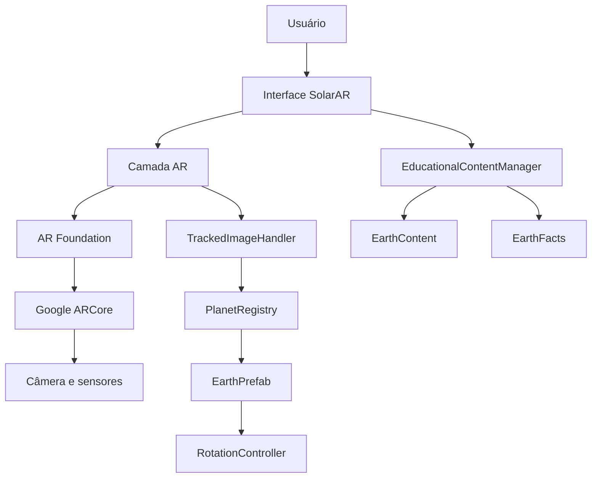
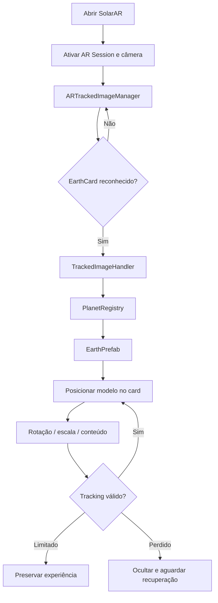
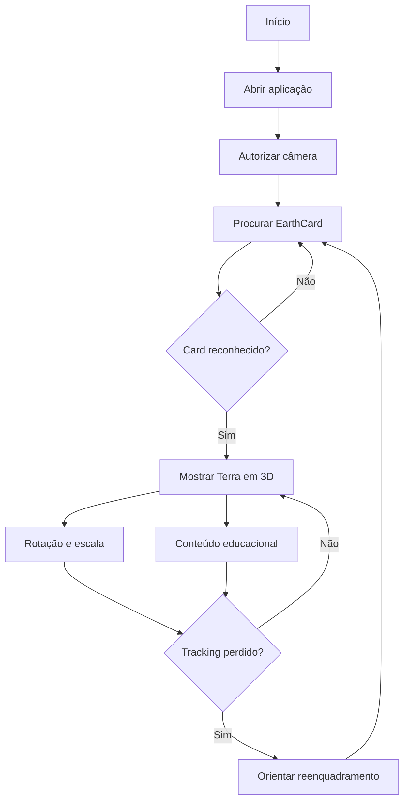
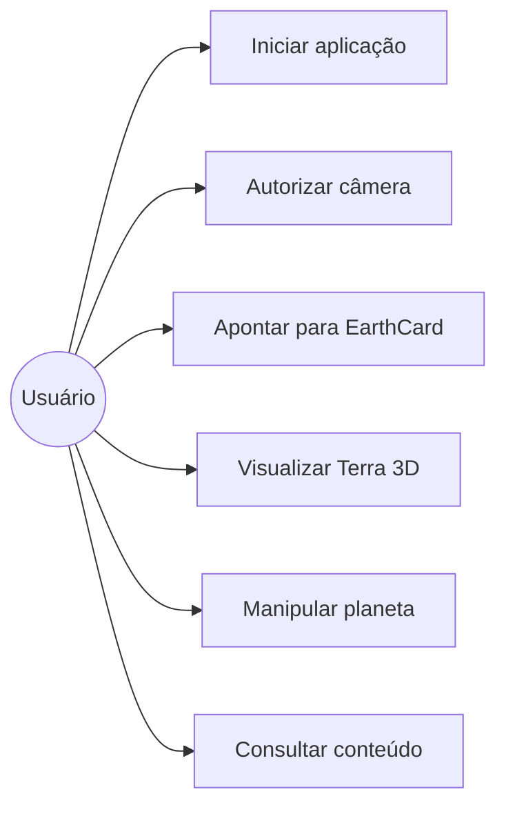

# SolarAR

> **Projeto acadêmico — UPX: Realidade Aumentada**  
> Aplicação educacional em Realidade Aumentada para exploração do Sistema Solar por meio de cards físicos interativos.


---

## 1. Identificação do Projeto

| Item | Informação |
|---|---|
| **Projeto** | SolarAR — Sistema Educacional do Sistema Solar em Realidade Aumentada |
| **Equipe** | SolarAR |
| **Curso** | Engenharia da Computação |
| **Disciplina** | UPX — Realidade Aumentada |
| **Docentes** | Daniel Ohata, Jéssica Danila Silva e Rosana Antonio |
| **Instituição** | Centro Universitário Facens — Sorocaba/SP |
| **Semestre** | 2026.2 |

### Integrantes

| Nome | RA | Responsabilidade |
|---|---|---|
| Emily Kaori | 35470 | Tech Lead; desenvolvimento Unity, integração de RA e testes |
| Éric Ferreira de Arruda | 211393 | Modelador; Desenvolvedor |
| Kevin Scavassin | 235185 | PMO; Planejamento e acompanhamento do projeto |
| Renan Lara | 235268 | Scrum Master; Organização do fluxo de trabalho |
| Roberto Dutra | 235789 | Pesquisa e esenvolvimento |

> **Antes da entrega:** substituir apenas os quatro campos de RA acima pelos números reais dos integrantes.

---

## 2. Visão Geral

O **SolarAR** é uma aplicação educacional em Realidade Aumentada voltada à aprendizagem introdutória do Sistema Solar. A proposta utiliza cards físicos como referências visuais: ao apontar a câmera de um smartphone Android para um card cadastrado, a aplicação reconhece a imagem e exibe sobre ela um modelo tridimensional do planeta correspondente.

O projeto busca tornar a visualização dos planetas mais concreta e interativa do que representações exclusivamente bidimensionais. O usuário pode observar o planeta em 3D, manipulá-lo e consultar informações educacionais curtas.

No estágio atual da entrega, o MVP implementa integralmente o fluxo da **Terra**, desde o reconhecimento do `EarthCard` até a exibição do modelo 3D e de seu conteúdo educacional. A arquitetura foi preparada para permitir a inclusão posterior dos demais planetas sem reestruturar o núcleo da aplicação.

---

## 3. Problema

O ensino do Sistema Solar costuma depender de imagens bidimensionais, diagramas e explicações abstratas. Para crianças em fase de alfabetização, compreender relações espaciais, forma dos planetas e representação tridimensional pode ser difícil quando o conteúdo é apresentado somente em livros ou telas planas.

O SolarAR foi desenvolvido como um recurso educacional complementar que associa um elemento físico simples — um card — a uma representação 3D interativa. O objetivo não é substituir a mediação pedagógica, mas oferecer uma forma visual e concreta de exploração.

---

## 4. Objetivos

### 4.1 Objetivo Geral

Desenvolver uma aplicação educacional em Realidade Aumentada baseada em cards interativos dos planetas para apoiar a aprendizagem introdutória do Sistema Solar.

### 4.2 Objetivos Técnicos

- Configurar um projeto Unity para Realidade Aumentada em Android.
- Utilizar AR Foundation e Google ARCore.
- Implementar reconhecimento de cards por **Image Tracking**.
- Associar cada imagem de referência a um prefab de planeta.
- Exibir um modelo 3D sobre o card reconhecido.
- Permitir rotação e redimensionamento do planeta.
- Disponibilizar conteúdo educacional configurável.
- Tratar reconhecimento, perda e recuperação de tracking.
- Testar no XR Simulation e em dispositivo Android real.
- Gerar um APK instalável do MVP.

---

## 5. Público-Alvo

O público-alvo do SolarAR é composto por **crianças em fase de alfabetização, aproximadamente entre 6 e 11 anos**, em contextos introdutórios de aprendizagem sobre o Sistema Solar.

A solução prioriza instruções curtas, interação direta, apenas um planeta em destaque por vez, conteúdo visual e textual simples e controles previsíveis. Nesta etapa não foi realizado experimento direto com crianças.

---

## 6. Funcionalidades

| ID | Funcionalidade | Descrição | Status |
|---|---|---|---|
| RF01 | Iniciar experiência RA | Inicializa a cena principal com câmera e sistemas de RA | ✅ |
| RF02 | Reconhecer EarthCard | Detecta o card cadastrado da Terra | ✅ |
| RF03 | Exibir Terra em 3D | Instancia o `EarthPrefab` associado ao card | ✅ |
| RF04 | Acompanhar tracking | Atualiza a pose do planeta conforme o card rastreado | ✅ |
| RF05 | Recuperar tracking | Preserva/recupera a experiência conforme o estado do tracking | ✅ |
| RF06 | Rotação automática | Mantém rotação suave do modelo visual da Terra | ✅ |
| RF07 | Interagir com o planeta | Permite manipulação do modelo | ✅ |
| RF08 | Redimensionar planeta | Permite alteração de escala com limites | ✅ |
| RF09 | Conteúdo educacional | Disponibiliza dados e curiosidades da Terra | ✅ |
| RF10 | Interface educacional | Exibe feedback e informações do planeta | ✅ |
| RF11 | Outros planetas | Inclusão dos demais sete planetas | ⬜ |
| RF12 | Áudio educacional | Narração opcional | ⬜ |

**Legenda:** ✅ Implementado · 🚧 Em desenvolvimento · ⬜ Planejado · ❌ Cancelado

---

## 7. Requisitos Não Funcionais

| ID | Categoria | Requisito |
|---|---|---|
| RNF01 | Compatibilidade | Executar em Android compatível com ARCore |
| RNF02 | Usabilidade | Apresentar instruções claras e interação simples |
| RNF03 | Desempenho | Manter o modelo 3D utilizável durante o tracking |
| RNF04 | Hardware | Requer câmera traseira e suporte a ARCore |
| RNF05 | Tracking | O card deve permanecer suficientemente visível |
| RNF06 | Interface | Respeitar Safe Area e diferentes proporções Android |
| RNF07 | Manutenibilidade | Separar AR, planetas, interação, educação e UI |
| RNF08 | Segurança | Não armazenar imagens capturadas nem segredos |

---

## 8. Tecnologias Utilizadas

| Tecnologia | Versão | Utilização |
|---|---|---|
| Unity | **6000.6.4f1** | Engine principal |
| C# | Compatível com Unity 6 | Programação |
| AR Foundation | **6.6.2** | Camada de abstração de RA |
| Google ARCore XR Plugin | **6.6.2** | Provider RA no Android |
| XR Plug-in Management | **4.7.0** | Gerenciamento XR |
| XR Simulation | **6.6.2** | Simulação RA no Editor |
| glTFast | **6.20.0** | Importação GLB |
| Input System | **1.20.0** | Entrada e interações |
| URP | **17.6.0** | Pipeline gráfico |
| Blender | **4.4.3** | Recursos 3D |
| Git / GitHub | — | Versionamento e repositório |
| Figma | — | Design e especificação visual |

---

## 9. Hardware Utilizado

| Equipamento | Modelo | Característica relevante | Utilização |
|---|---|---|---|
| Smartphone Android | **Modelo não registrado no README até o momento** | Compatível com ARCore | Teste do APK e RA |
| Computador de desenvolvimento | Linux x86_64 | Unity Editor, Git e ferramentas | Desenvolvimento |

Para obter os dados do smartphone conectado:

```bash
adb shell getprop ro.product.manufacturer
adb shell getprop ro.product.model
adb shell getprop ro.build.version.release
```

> Antes da entrega, substituir “Modelo não registrado” pelo dispositivo real testado.

---

## 10. Arquitetura do Sistema



A arquitetura separa AR, conteúdo 3D, interação, dados educacionais e interface para reduzir acoplamento e facilitar a expansão futura.

---

## 11. Funcionamento da Realidade Aumentada

### 11.1 Técnica utilizada

O SolarAR utiliza **Image Tracking**. O `EarthCard` é cadastrado em uma `XRReferenceImageLibrary`. Quando o ARCore reconhece a imagem, o AR Foundation fornece um `ARTrackedImage` com pose e estado de tracking.

### 11.2 Fluxo técnico



### 11.3 Estados

- **Tracking:** planeta ativo e pose atualizada.
- **Limited:** perda temporária de precisão; a experiência é preservada quando possível.
- **None:** instância pode ser ocultada.
- **Removed:** instância associada é removida.

---

## 12. Estrutura do Projeto

```text
SolarAR/
├── UnityApp/
│   ├── Assets/SolarAr/
│   │   ├── AR/
│   │   ├── Education/
│   │   ├── Interaction/
│   │   ├── Planets/
│   │   ├── Scenes/
│   │   ├── Simulation/
│   │   └── UI/
│   ├── Packages/
│   └── ProjectSettings/
├── docs/
│   └── design/
├── AGENTS.md
├── README.md
└── .gitignore
```

| Pasta | Finalidade |
|---|---|
| `AR` | Image Tracking, referências e scripts de RA |
| `Planets` | Modelos, prefabs e comportamentos |
| `Interaction` | Gestos e manipulação |
| `Education` | Conteúdo educacional configurável |
| `UI` | Interface e feedback |
| `Scenes` | Cena principal `MainAR` |
| `Simulation` | Ambiente XR Simulation |
| `docs/design` | Especificação e referências Figma |

---

## 13. Principais Scripts e Componentes

| Script / Componente | Responsabilidade |
|---|---|
| `TrackedImageDebugLogger.cs` | Registra mudanças de tracking durante desenvolvimento |
| `TrackedImageHandler.cs` | Processa o ciclo de vida do `ARTrackedImage` e controla a instância |
| `PlanetRegistry.cs` | Mapeia a imagem de referência para o prefab |
| `RotationController.cs` | Controla rotação automática do modelo visual |
| `PlanetContent.cs` | Define dados educacionais de um planeta |
| `PlanetFact.cs` | Representa uma curiosidade |
| `PlanetFacts.cs` | Agrupa curiosidades por planeta |
| `EducationalContentManager.cs` | Fornece conteúdo usando `planetKey` |
| `ARTrackedImageManager` | Componente AR Foundation de Image Tracking |
| `SolarARReferenceImageLibrary` | Biblioteca que contém `EarthCard` |

---

## 14. Dependências

```text
AR Foundation 6.6.2
ARCore XR Plugin 6.6.2
XR Plug-in Management 4.7.0
XR Simulation 6.6.2
glTFast 6.20.0
Input System 1.20.0
URP 17.6.0
```

Registradas em `UnityApp/Packages/manifest.json` e `packages-lock.json`.

---

## 15. Configuração do Ambiente

### Pré-requisitos

- Unity Hub;
- Unity **6000.6.4f1**;
- Android Build Support;
- Android SDK/NDK e OpenJDK;
- Git;
- smartphone Android compatível com ARCore.

### Procedimento

```bash
git clone https://github.com/Emilyksori/SolarAR.git
cd SolarAR
```

1. Abra o Unity Hub.
2. Adicione/abra a pasta `SolarAR/UnityApp`.
3. Aguarde a importação dos pacotes.
4. Abra `Assets/SolarAr/Scenes/MainAR.unity`.
5. Em XR Plug-in Management, confirme ARCore no Android e XR Simulation no Editor/Standalone.

---

## 16. Como Executar

### XR Simulation

1. Abra `MainAR.unity`.
2. Confirme `SolarAR_Backyard` nas preferências de XR Simulation.
3. Clique em **Play**.
4. Navegue até `EarthCard_Simulated`.
5. Aponte a câmera simulada para o card.

### Android

1. **File → Build Profiles → Android**.
2. Confirme `MainAR` no build.
3. Clique em **Build**.
4. Salve, por exemplo, em `UnityApp/Builds/Android/SolarAR.apk`.

Instalação por ADB:

```bash
adb devices
adb install -r UnityApp/Builds/Android/SolarAR.apk
```

---

## 17. Como Utilizar a Aplicação

1. Abra o SolarAR no smartphone.
2. Autorize a câmera.
3. Posicione o `EarthCard` em uma superfície visível.
4. Aponte a câmera para o card.
5. Aguarde o reconhecimento.
6. Observe a Terra em 3D sobre a referência.
7. Interaja com o planeta.
8. Consulte o conteúdo educacional.
9. Caso o tracking seja perdido, reposicione o card na câmera.

---

## 18. Fluxo de Funcionamento



---

## 19. Caso de Uso



---

## 20. Fluxo de Navegação

```text
Aplicação
  ↓
Experiência AR
  ↓
Procurando EarthCard
  ↓
Card reconhecido
  ↓
Terra em 3D
  ↓
Informações educacionais
  ↓
Perda / recuperação de tracking
```

---

## 21. Interface

A especificação visual está em `docs/design/`, incluindo `SolarAR-UI-Spec.md` e exportações do Figma. A referência usa base `412 × 915`, fundo noturno, azul/ciano para navegação, amarelo para destaque e superfícies claras para conteúdo educacional.

### Capturas reais

Armazene em `docs/images/` pelo menos:

```text
solarar-searching.png
solarar-earth-tracking.png
```

Com smartphone conectado por ADB:

```bash
mkdir -p docs/images
adb exec-out screencap -p > docs/images/solarar-earth-tracking.png
```

Depois adicione ao README, se os arquivos existirem:

```markdown

```

---

## 22. Testes Técnicos

| Teste | Procedimento | Resultado esperado | Resultado obtido | Status |
|---|---|---|---|---|
| Inicialização | Abrir aplicativo | Aplicação inicia | Funcionou | ✅ |
| Câmera | Iniciar RA | Câmera ativa | Funcionou | ✅ |
| XR Simulation | Executar `MainAR` | Ambiente carrega | Funcionou | ✅ |
| Image Tracking | Apontar `EarthCard` | Card reconhecido | Detectado | ✅ |
| Objeto 3D | Reconhecer card | Terra exibida | Exibida | ✅ |
| Tracking | Movimentar/enquadrar card | Modelo acompanha referência | Funcionou | ✅ |
| Recuperação | Perder/recuperar referência | Experiência recupera | Funcionou | ✅ |
| Rotação | Exibir planeta | Terra gira | Funcionou | ✅ |
| Escala/interação | Manipular planeta | Escala utilizável | Funcionou | ✅ |
| Conteúdo educacional | Abrir informações | Conteúdo exibido | Funcionou | ✅ |
| Build Android | Gerar APK | APK criado | Gerado | ✅ |
| Android real | Instalar e executar | MVP funciona | Funcionou | ✅ |

---

## 23. Dispositivos Testados

| Dispositivo | Sistema | Versão | Resultado |
|---|---|---|---|
| Smartphone Android compatível com ARCore | Android | **Versão não registrada no README** | MVP executado com sucesso |

> Registrar fabricante, modelo e versão do Android antes da entrega, se disponíveis.

---

## 24. Limitações Conhecidas

- A versão atual implementa apenas o **planeta Terra**.
- Os demais planetas ainda serão adicionados.
- O Image Tracking depende de visibilidade e qualidade da referência.
- Iluminação inadequada pode reduzir a estabilidade.
- A calibração final pode variar conforme o tamanho físico do card.
- A interface ainda pode receber refinamentos de fidelidade ao Figma.
- Áudio educacional não faz parte do MVP atual.
- A compatibilidade foi verificada apenas no dispositivo efetivamente testado.

---

## 25. Evidências de Funcionamento

A solução foi validada no XR Simulation e em dispositivo Android compatível com ARCore.

**Demonstração do reconhecimento e interação:**

[▶ Assistir ao vídeo de demonstração](docs/evidencia_reconhecimento_de_card.mp4)

---

## 26. Repositórios e Recursos

| Recurso | Link / Local |
|---|---|
| Código-fonte | https://github.com/Emilyksori/SolarAR |
| Especificação UI | `docs/design/SolarAR-UI-Spec.md` |
| Referências Figma | `docs/design/figma-styles.jpg`, `figma-components.jpg`, `figma-screens.jpg` |
| Cena principal | `UnityApp/Assets/SolarAr/Scenes/MainAR.unity` |

---

## 27. Cronograma Técnico

| Atividade | Responsável | Status |
|---|---|---|
| Planejamento e acompanhamento | Kevin Scavassin | ✅ |
| Desenvolvimento Unity e integração RA | Emilya Kaori | ✅ |
| Organização do fluxo | Renan Lara | ✅ |
| Pesquisa e desenvolvimento | Roberto Dutra | ✅ |
| XR Simulation | Emilya Kaori | ✅ |
| Image Tracking da Terra | Emilya Kaori | ✅ |
| Integração 3D | Equipe | ✅ |
| Conteúdo educacional | Equipe | ✅ |
| Testes técnicos | Equipe | ✅ |
| Build e teste Android | Equipe | ✅ |
| Outros planetas | Equipe | ⬜ |
| Refinamento de UI | Equipe | 🚧 |

---

## 28. Controle de Versão

O projeto utiliza Git e GitHub, com branches de funcionalidades e commits descritivos seguindo um padrão simplificado de Conventional Commits:

```text
feat: nova funcionalidade
fix: correção de bug
docs: documentação
chore: configuração ou manutenção
```

O histórico registra a evolução de AR Foundation, XR Simulation, Image Tracking, integração da Terra, conteúdo educacional e MVP Android.

---

## 29. Problemas Encontrados e Soluções

### XR Simulation sem Image Tracking ativo

**Problema:** ambiente simulado aparecia, mas o `ARTrackedImageManager` não recebia eventos.  
**Causa:** Fast Enter Play Mode mantinha o XR loader em estado persistente.  
**Solução:** restaurar o ciclo completo de Play Mode.

### Tamanho físico inconsistente

**Problema:** `EarthCard_Simulated` utilizava dimensão diferente da library.  
**Causa:** imagem simulada em `1 × 1 m`, referência em aproximadamente `0,10 × 0,106 m`.  
**Solução:** alinhar as dimensões.

### Terra não aparecia após reconhecimento

**Problema:** tracking detectava `EarthCard`, mas o planeta não aparecia.  
**Causa:** inconsistências de associação/ciclo de vida no `PlanetRegistry` e `TrackedImageHandler`.  
**Solução:** revisar `EarthCard → EarthPrefab`, diagnosticar o fluxo e garantir instanciação/ativação correta.

### Instabilidade em `Limited`

**Problema:** pequenas oscilações podiam ocultar o planeta.  
**Causa:** comportamento inicialmente dependente apenas de `Tracking`.  
**Solução:** tratar `Limited` como perda temporária e preservar a experiência quando possível.

### Build And Run sem dispositivo

**Problema:** build inicialmente reportado como falha.  
**Causa:** uso de **Build And Run** sem Android conectado.  
**Solução:** utilizar **Build** para gerar o APK e instalar depois por ADB.

---

## 30. Melhorias Futuras

- adicionar Mercúrio, Vênus, Marte, Júpiter, Saturno, Urano e Netuno;
- criar os respectivos cards físicos;
- expandir conteúdo educacional;
- implementar áudio opcional;
- refinar a UI conforme o Figma;
- ampliar testes em diferentes dispositivos Android;
- realizar avaliação exploratória de adequação pedagógica.

---

## 31. Custos e Recursos

| Recurso | Tipo | Custo / Condição |
|---|---|---|
| Unity | Software | Licença utilizada no contexto acadêmico |
| Blender | Software | Gratuito |
| Git / GitHub | Software / serviço | Gratuito para o uso realizado |
| Figma | Serviço | Design da interface |
| Smartphone Android | Hardware | Equipamento da equipe |
| Computador | Hardware | Equipamento da equipe |

---

## 32. Licença

Projeto acadêmico desenvolvido para fins educacionais na disciplina **UPX — Realidade Aumentada**, do curso de Engenharia da Computação do Centro Universitário Facens.

Recursos de terceiros permanecem sujeitos às respectivas licenças.

---

## 33. Autores

- **Emilya Kaori** — Tech Lead, Unity, integração de RA e testes
- **Kevin Scavassin** — PMO e planejamento
- **Renan Lara** — Scrum Master e organização do fluxo
- **Roberto Dutra** — pesquisa e desenvolvimento

**Instituição:** Centro Universitário Facens  
**Curso:** Engenharia da Computação  
**Disciplina:** UPX — Realidade Aumentada  
**Semestre:** 2026.2

---

## Checklist de Entrega

- [x] Código-fonte atualizado
- [x] README preenchido com o estado atual
- [x] Versões das tecnologias registradas
- [x] Arquitetura apresentada
- [x] Funcionamento da RA explicado
- [x] Estrutura documentada
- [x] Scripts principais descritos
- [x] Configuração documentada
- [x] Execução documentada
- [x] Utilização documentada
- [x] Testes registrados
- [x] Limitações documentadas
- [x] Histórico preservado por commits
- [x] RAs conferidos no README
- [x] Modelo/versão Android conferidos
- [ ] Screenshots adicionados em `docs/images/`
- [ ] Link do repositório conferido no navegador

---

> Este README representa o estágio atual do SolarAR no momento da entrega: um MVP Android funcional com Image Tracking da Terra, modelo 3D interativo, conteúdo educacional e arquitetura preparada para expansão futura.
